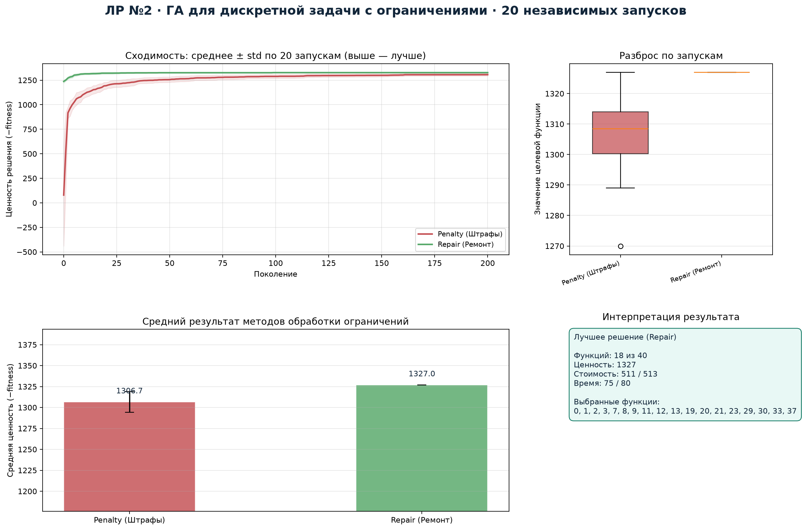
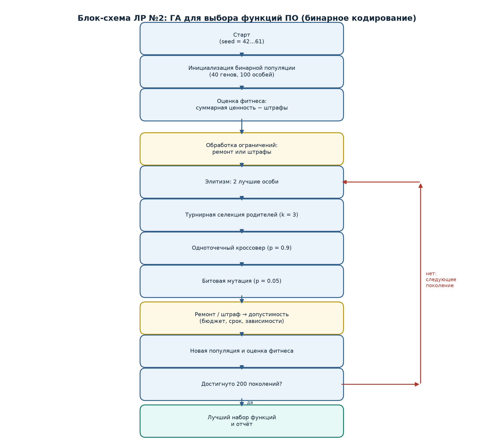
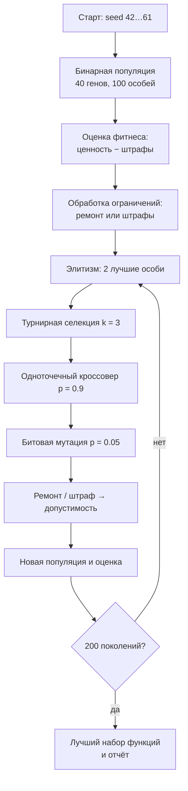
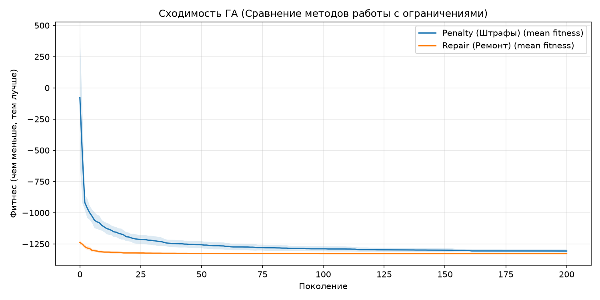

# Лабораторная работа №2
## Генетический алгоритм для дискретной задачи с ограничениями


**Студент:** Якимов Максим Андреевич  
**Группа:** Б24-517, № в группе 30  
**Вариант:** 4  
**Дисциплина:** «Эволюционное программирование и генетические алгоритмы»

---

## Дашборд экспериментов



Дашборд показывает сходимость двух методов обработки ограничений, разброс
результатов, средние значения и состав лучшего найденного набора функций.

## Блок-схема алгоритма





## Постановка задачи

Выбрать подмножество из 40 функций программного продукта, максимизируя
суммарную бизнес-ценность при ограничениях:

- стоимость разработки $\le 513$;
- время разработки $\le 80$;
- если выбрана функция $i$, выбраны все её зависимости.

**Генотип:** бинарная строка длины 40. **Цель:**
$\max\sum_i v_i x_i$ при ограничениях на бюджет, срок и зависимости.

## Методы обработки ограничений

1. **Штрафы.** Нарушения бюджета/срока штрафуются с коэффициентом 100,
   нарушения зависимостей — 1000.
2. **Ремонт.** Сначала добавляются недостающие зависимости, затем удаляются
   наименее эффективные функции по $v_i/(c_i+t_i)$, пока план не станет
   допустимым.

## Результаты 20 независимых запусков

| Метод | min | mean | median | std | max |
|---|---:|---:|---:|---:|---:|
| Штрафы | −1327 | −1306.7 | −1308.5 | 12.47 | −1270 |
| **Ремонт** | **−1327** | **−1327.0** | **−1327.0** | **0.00** | **−1327** |

Отрицательные значения — это $-\text{ценность}$; чем меньше, тем лучше.
Метод ремонта во всех 20 запусках находит решение с ценностью 1327.

## Лучшее решение

| Показатель | Значение |
|---|---:|
| Выбрано функций | 18 из 40 |
| Суммарная стоимость | 511 / 513 |
| Суммарное время | 75 / 80 |
| Суммарная ценность | **1327** |

Выбранные функции: `0, 1, 2, 3, 7, 8, 9, 11, 12, 13, 19, 20, 21, 23, 29,
30, 33, 37`. Зависимости функций 3, 19 и 37 выполнены.

## Графики

| Сходимость | Сравнение |
|---|---|
|  |  |

## Быстрый запуск

```bash
python -m venv venv
venv\Scripts\activate
pip install -r requirements.txt
python main.py
```

Результаты в `lab2_out/`:

- `lab2_results.csv` — 20 запусков двух методов;
- `lab2_best_solution.json` — лучшее решение в машиночитаемом виде;
- `lab2_histories.npz` — траектории сходимости;
- `lab2_convergence.png`, `lab2_dashboard.png`, `lab2_block_schema.png`.

## Отчёт

Готовый PDF: [`report.pdf`](report.pdf). Исходник: [`report.md`](report.md).

## Вывод

Для дискретной задачи с жёсткими ограничениями ремонт предпочтительнее
штрафов: он всегда работает с допустимыми решениями и даёт стабильный
результат (std = 0), тогда как штрафы тратят бюджет на исследование
недопустимых областей.
