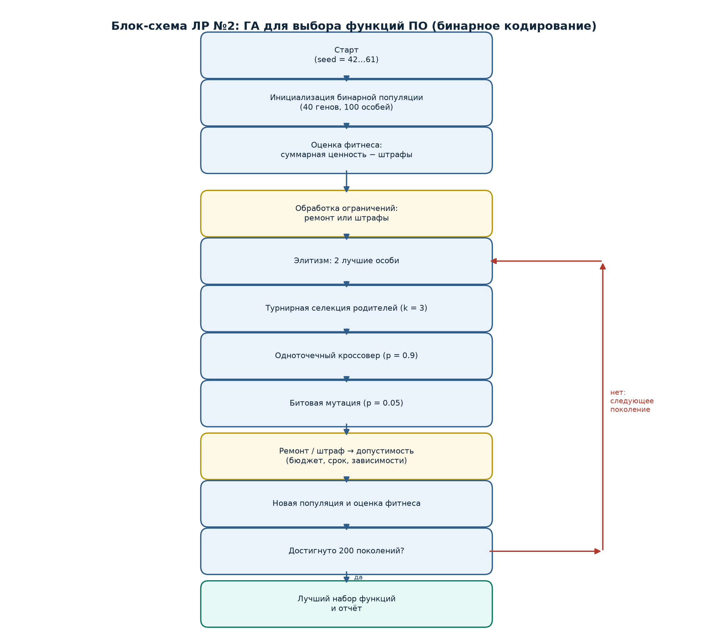
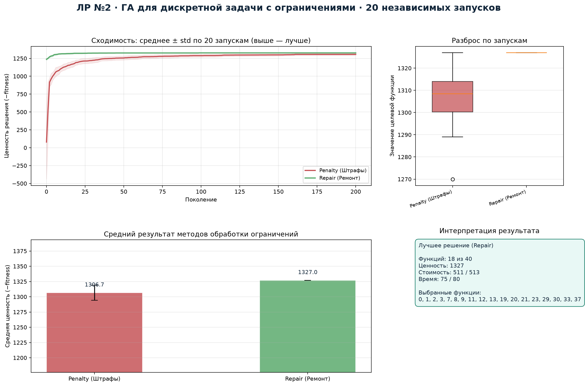

# 1. Постановка задачи и вариант

**Вариант:** 4. Задача — формирование набора функций программного продукта
при ограничениях на бюджет, срок разработки и зависимости функций.

Требуется выбрать подмножество из $N=40$ функций, максимизирующее суммарную
бизнес-ценность, при условиях:

- суммарная стоимость разработки не превышает бюджет $B=513$;
- суммарное время разработки не превышает дедлайн $T=80$;
- если выбрана функция $i$, выбраны все функции из её списка зависимостей.

# 2. Формальное описание

- Множество функций $I=\{1,\ldots,40\}$.
- Параметры: стоимость $c_i$, время $t_i$, ценность $v_i$, множество
  зависимостей $D_i\subset I$.
- Переменные: $x_i\in\{0,1\}$, $i\in I$.
- Целевая функция: $\max \sum_i v_i x_i$.
- Ограничения:
  $$\sum_i c_i x_i\le B,\qquad \sum_i t_i x_i\le T,\qquad
  x_i\le x_j\ \ \forall j\in D_i.$$

# 3. Представление особи и декодирование

**Генотип:** бинарная строка длины 40. Ген $x_i=1$ означает, что функция
включена в продукт. **Фенотип:** выбранное подмножество функций; декодирование
сводится к перечислению единичных генов.

Такое представление напрямую отражает структуру задачи о подмножестве и
позволяет применять битовую мутацию и одноточечный кроссовер.

# 4. Алгоритм и обработка ограничений

| Параметр | Значение |
|---|---|
| Популяция | 100 |
| Поколения | 200 |
| Селекция | турнирная, $k=3$ |
| Кроссовер | одноточечный, $p_c=0.9$ |
| Мутация | битовая инверсия, $p_m=0.05$ |
| Элитизм | 2 особи |
| Seed | 42, серия 42…61 |

Сравниваются два способа работы с ограничениями.

1. **Штрафы.** Нарушения бюджета и срока штрафуются с коэффициентом 100,
   нарушения зависимостей — с коэффициентом 1000. Фитнес:
   $F=-\sum v_i x_i + 100\max(0,\sum c_i x_i-B)+100\max(0,\sum t_i x_i-T)+1000\cdot\text{viol}$.
2. **Ремонт.** Недопустимая особь восстанавливается: сначала принудительно
   добавляются недостающие зависимости, затем удаляются наименее ценные
   функции (по отношению $v_i/(c_i+t_i)$), пока не выполнены бюджет и срок.

# 5. Блок-схема

# 6. Результаты 20 независимых запусков

| Метод | min | mean | median | std | max |
|---|---:|---:|---:|---:|---:|
| Штрафы | −1327 | −1306.7 | −1308.5 | 12.47 | −1270 |
| Ремонт | **−1327** | **−1327.0** | **−1327.0** | **0.0** | **−1327** |

Знак минус соответствует минимизации отрицательной ценности; чем меньше
значение, тем выше ценность. Метод ремонта во всех 20 запусках находит
решение с ценностью 1327, метод штрафов — от 1270 до 1327.

# 7. Лучшее найденное решение

- Выбрано функций: **18 из 40**.
- Суммарная стоимость: **511** при бюджете 513.
- Суммарное время: **75** при дедлайне 80.
- Суммарная ценность: **1327**.

Выбранные функции: 0, 1, 2, 3, 7, 8, 9, 11, 12, 13, 19, 20, 21, 23, 29,
30, 33, 37. Зависимости для функций 3, 19 и 37 выполнены (в наборе присутствуют
функции 2 и 3 соответственно).

# 8. Сравнение с жадной эвристикой

Жадный алгоритм сортирует функции по убыванию $v_i/(c_i+t_i)$ и добавляет
их, пока хватает бюджета. Он быстро строит допустимое решение, но не учитывает
сложный граф зависимостей и может «застрять» на локальном выборе. ГА с
ремонтом находит решение ценностью 1327; жадная эвристика на тех же данных
даёт меньшее или равное значение, а ГА способен перебирать неочевидные
комбинации функций.

# 9. Выводы

1. Для дискретной задачи с жёсткими ограничениями ремонт предпочтительнее
   штрафов: он сокращает пространство поиска до допустимых решений и даёт
   стабильный результат (std = 0).
2. Бинарное кодирование, одноточечный кроссовер и битовая мутация корректно
   сохраняют структуру решения.
3. Найденный набор функций удовлетворяет всем ограничениям и имеет высокую
   суммарную ценность; результат воспроизводится серией из 20 запусков.
